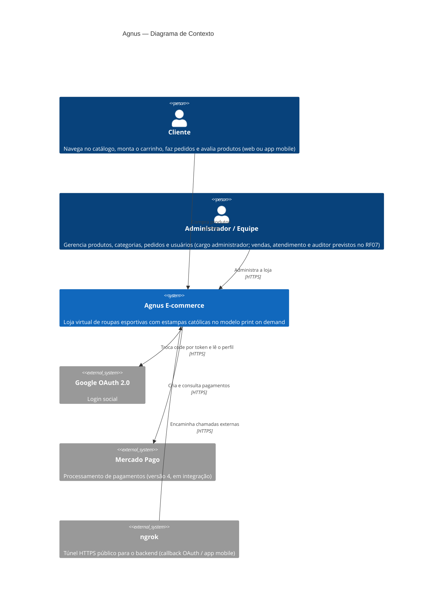
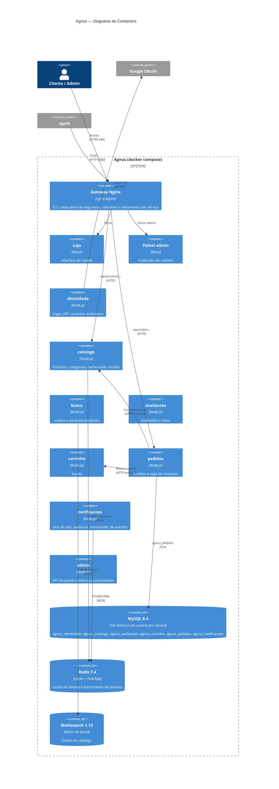
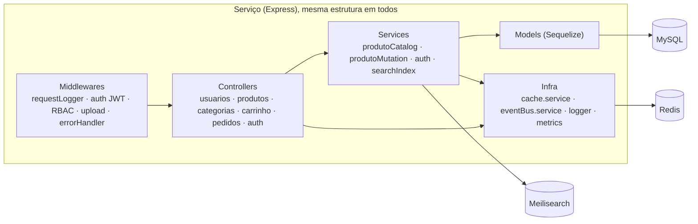

# Diagramas C4 — Contexto e Containers

Os diagramas estão em [Mermaid](https://mermaid.js.org/) e são renderizados automaticamente pelo GitHub.

## Nível 1 — Contexto do sistema

Quem usa o Agnus e com quais sistemas externos ele conversa.

## Nível 2 — Containers

Cada caixa é um container do `docker-compose.yml`. A rede `data` é **interna** (sem saída para a internet). De fora, só o gateway (80/443) é acessível. Contratos completos em [microsservicos.md](microsservicos.md).

## Nível 3 — Componentes de um serviço (resumo)

| Camada | Pasta | Responsabilidade |
| --- | --- | --- |
| Middlewares | `services/comum/src/middlewares` | Correlação de logs (`X-Request-Id`), autenticação, autorização por permissão, upload Multer, tratamento centralizado de erros |
| Controllers | `services/<serviço>/src/controllers` | Validação de entrada e montagem da resposta HTTP |
| Services | `services/<serviço>/src/services` | Regras de negócio, transações, cache e eventos |
| Types/DTOs | `services/<serviço>/src/types` | Contratos de entrada/saída (`*Body`, `*Query`, `*RouteParams`) e eventos |
| Models | `services/<serviço>/src/models` | Mapeamento objeto-relacional |
| Config | `services/comum/src/config` | Banco, Redis, TTLs de cache, matriz de permissões |
