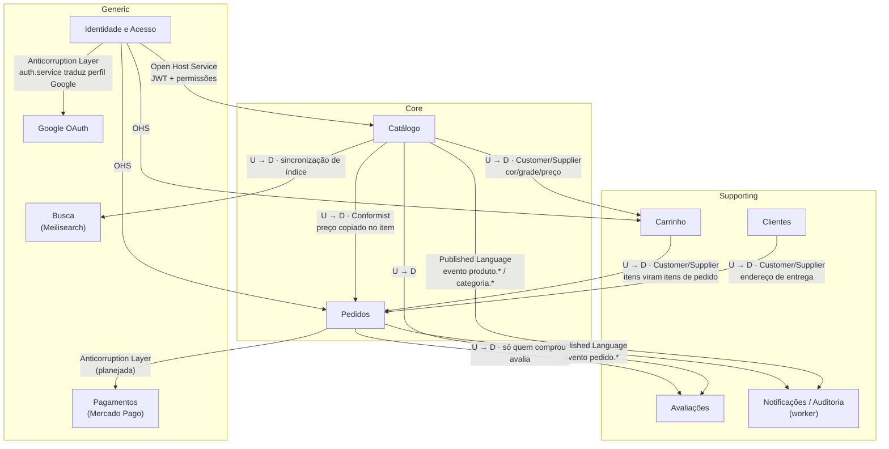
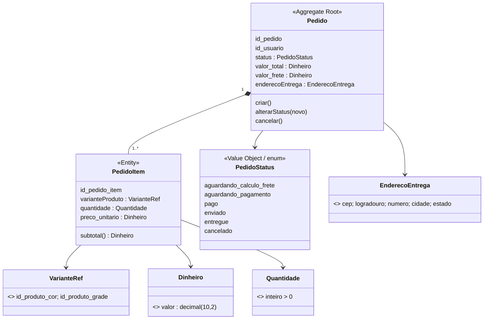
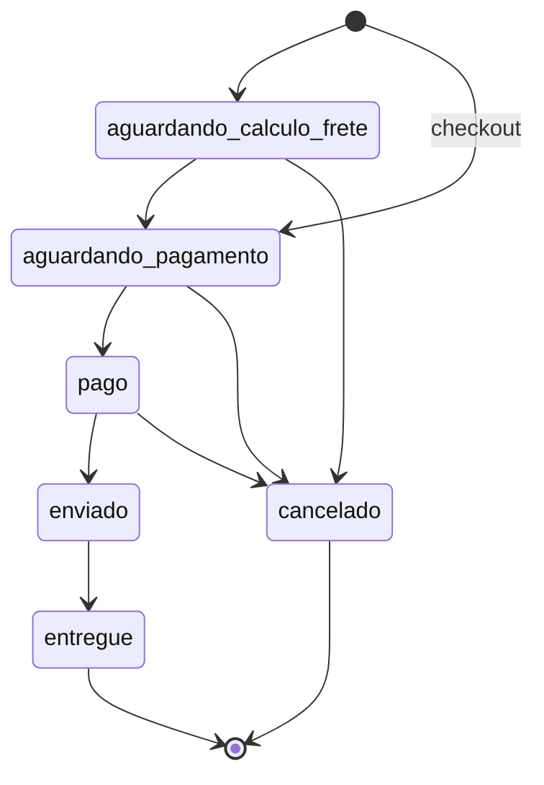

# Estilos Arquiteturais e DDD

## Estilo arquitetural

- **Monólito modular em camadas** ([ADR 0001](adr/0001-monolito-modular.md)): `middlewares → controllers → services → models`, com tipos de entrada/saída (DTOs) em `src/types`.
- **Event-driven nas bordas** ([ADR 0004](adr/0004-eventos-redis-pubsub.md)): efeitos colaterais entre contextos usam eventos de domínio no Redis Pub/Sub.
- **Cache-aside** nas leituras do catálogo ([ADR 0003](adr/0003-cache-redis-cache-aside.md)).

## Domínio e subdomínios

O domínio é o **varejo on-line de vestuário esportivo católico sob demanda (print on demand)**.

| Subdomínio | Tipo | Justificativa |
| --- | --- | --- |
| **Catálogo e vitrine** (produtos, variações cor/grade, fotos, categorias, busca, destaques) | **Core** | É o diferencial da marca: estampas, curadoria e experiência de descoberta |
| **Vendas / Pedidos** (carrinho, checkout, ciclo de vida do pedido) | **Core** | O modelo print on demand depende de o pedido disparar a produção corretamente |
| **Avaliações** (notas, comentários, fotos de clientes) | **Supporting** | Gera prova social, mas não é diferencial competitivo |
| **Identidade e acesso** (cadastro, login, Google OAuth, RBAC, histórico de senhas) | **Generic** | Problema resolvido de forma padrão (JWT, OAuth 2.0) |
| **Clientes** (endereços e contatos) | **Supporting** | Necessário para entrega e comunicação |
| **Pagamentos** (Mercado Pago) | **Generic** | Terceirizado para um gateway |
| **Busca** (Meilisearch) | **Generic** | Ferramenta de mercado |
| **Notificações e auditoria** (worker) | **Supporting** | Reage a eventos dos contextos core |

## Bounded Contexts

| Bounded Context | Responsabilidade | Modelos / tabelas | Código |
| --- | --- | --- | --- |
| **Catálogo** | Cadastro e exposição de produtos e suas variações | `Produtos`, `ProdutoCores`, `ProdutoGrades`, `ProdutoFotos`, `Categorias` | `produtoCatalog.service`, `produtoMutation.service`, `produtos/categorias/produtoCores/produtoGrades/produtoFotos.controller` |
| **Carrinho** | Intenção de compra antes do pedido; valida a variante (cor + grade do mesmo produto) e a quantidade | `Carrinhos`, `CarrinhoItens` | `carrinhos/carrinhoItens.controller` |
| **Pedidos** | Pedido confirmado e seu ciclo de vida | `Pedidos`, `PedidoItens` | `pedidos/pedidoItens.controller`, `pedidoAuthorization.middleware` |
| **Identidade e Acesso** | Quem é o usuário e o que pode fazer | `Usuarios`, `UsuarioSenhasHistorico`, `config/permissions.ts` | `auth.service`, `auth/usuarios.controller`, `auth/permission.middleware` |
| **Clientes** | Dados de entrega e contato do cliente | `UsuarioEnderecos`, `UsuarioContatos` | `usuarioEnderecos/usuarioContatos.controller` |
| **Avaliações** | Opinião do cliente sobre produtos comprados | `AvaliacaoProdutos`, `AvaliacaoFotos` | `avaliacaoProdutos/avaliacaoFotos.controller` |
| **Busca** | Índice textual do catálogo | índice `produtos` (Meilisearch) | `produtoSearchIndex.service` |
| **Pagamentos** | Cobrança via gateway | — (integração em andamento) | — |
| **Notificações/Auditoria** | Efeitos colaterais assíncronos | lista Redis `agnus:auditoria:eventos` | `worker.ts` |

> **Linguagem ubíqua:** a mesma palavra muda de sentido conforme o contexto. Para o **Catálogo**, "produto" é a peça com preço base e variações. Para **Pedidos**, o que importa é o **item vendido**: cor + grade + quantidade + **preço unitário congelado no momento da compra**.

## Context Map

| Relação | Padrão | Como aparece no código |
| --- | --- | --- |
| Identidade → todos | **Open Host Service** | Middleware `authenticateToken` + `checarPermissao(PERMISSIONS.X)`; o JWT é o protocolo público |
| Catálogo → Carrinho/Pedidos | **Customer/Supplier** | Itens referenciam `id_produto_cor` e `id_produto_grade` |
| Catálogo → Pedidos (preço) | **Conformist** (cópia) | `PedidoItens.preco_unitario` guarda o preço da época; mudar o produto não altera pedidos antigos |
| Catálogo/Pedidos → Notificações | **Published Language** | Envelope `AgnusEvent` (`src/types/event.types.ts`) em `agnus.eventos.*` |
| Identidade → Google | **Anticorruption Layer** | `AuthService.findOrCreateGoogleUser` traduz o `GoogleUserInfo` para `Usuarios` |
| Pedidos → Pagamentos | **Anticorruption Layer** (planejada) | O status do Mercado Pago será traduzido para `PedidoStatus` |

## Entities, Value Objects e Aggregates

### Contexto **Pedidos**

| Elemento | Tipo | Por quê |
| --- | --- | --- |
| `Pedido` | **Aggregate Root** | Fronteira de consistência: itens, total e status mudam juntos. Acesso externo só pelo id do pedido (`/orders/:id`), com autorização de dono/admin (`authorizeOrderOwnerOrAdmin`) |
| `PedidoItem` | **Entity** (interna ao agregado) | Tem identidade própria, mas não existe sem o pedido |
| `PedidoStatus` | **Value Object** | Conjunto fechado de valores, validado na entrada (`src/types/pedido.types.ts`). Fluxo esperado: `aguardando_pagamento → pago → enviado → entregue`, com `cancelado` antes do envio |
| `Dinheiro` (`valor_total`, `preco_unitario`, `valor_frete`) | **Value Object** | Definido só pelo valor (decimal 10,2), imutável, sem identidade |
| `Quantidade` | **Value Object** | Inteiro positivo, validado na entrada |
| `VarianteRef` (cor + grade) | **Value Object** | Referência ao Catálogo por id, nunca pelo objeto (fronteira entre agregados) |
| `EnderecoEntrega` | **Value Object** | Na entrega, importa o conteúdo do endereço, não sua identidade |

**Invariantes do agregado Pedido**

| # | Invariante | Situação no código |
| --- | --- | --- |
| 1 | O pedido pertence a um único usuário, e o endereço de entrega precisa ser desse usuário | ✅ Garantida em `PedidosController.create/update` |
| 2 | Só o dono ou um usuário com permissão vê o pedido | ✅ `authorizeOrderOwnerOrAdmin`; criar pedido manual e mexer em itens exige `pedidos:criar` / `pedidos:atualizar` (`src/routes/pedidos.routes.ts`) |
| 3 | `preco_unitario` é copiado no momento da compra e não muda quando o produto muda | ✅ Coluna própria em `PedidoItens` |
| 4 | Mudança de status publica `pedido.atualizado` com `status_anterior` e `status` | ✅ `PedidosController.update` |
| 5 | O cliente não cria pedido sem itens (RF58/RF90) | ✅ O único caminho do cliente é `POST /orders/checkout`, que recusa sacola vazia (400) e grava pedido + itens + baixa da sacola numa transação (`CheckoutService.finalizar`). O lançamento manual da equipe nasce aberto e recebe os itens em seguida |
| 6 | `valor_total = Σ subtotais + valor_frete` | ✅ Nunca vem do cliente: o checkout calcula no servidor e `PedidoRegrasService.recalcularTotal` refaz o total a cada item incluído, alterado ou removido e a cada mudança de frete. Um `valor_total` enviado é ignorado |
| 7 | Transições de status seguem o fluxo esperado | ✅ Máquina de estados em `PedidoRegrasService.podeTransitar`; transição inválida retorna **409** |
| 8 | Itens só mudam enquanto o pedido está aberto (`aguardando_calculo_frete` / `aguardando_pagamento`) | ✅ `PedidoItensController` retorna **409** para pedido pago, enviado, entregue ou cancelado |

As regras ficam num único lugar, [`pedidoRegras.service.ts`](../../agnus-back/src/services/pedidoRegras.service.ts), e são cobertas por testes em `tests/controllers/pedidos.controller.spec.ts` e `tests/routes/pedidos.routes.spec.ts` (US-22 e US-23 no [backlog](../gestao/product-backlog.md)).

### Contexto **Catálogo**

| Elemento | Tipo | Observação |
| --- | --- | --- |
| `Produto` | **Aggregate Root** | Criado/alterado/removido **numa única transação** junto com cores, grades e fotos (`ProdutoMutationService.runCreateTransaction`) |
| `ProdutoCor`, `ProdutoGrade`, `ProdutoFoto` | **Entities** internas | Não fazem sentido fora do produto; removidas junto com ele |
| `Categoria` | **Aggregate Root** separado | Ciclo de vida próprio; o produto a referencia só por `id_categoria` |
| `CodigoRGB` | **Value Object** | Normalizado por `utils/color.ts` (`normalizeRgbColor`) |
| `Preco` (`preco_base`, `preco_custo`, `acrescimo`) | **Value Object** | Preço final da variante = base + acréscimo da cor + acréscimo da grade |

**Invariantes:** o produto precisa de nome, preço base e pelo menos uma cor com foto. Um produto com pedidos vinculados não pode ser removido, só desativado (`409`).
