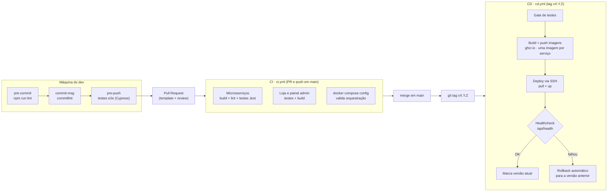

# Entrega Contínua

## 1. Pipeline CI/CD

| Arquivo | Gatilho | Etapas |
| --- | --- | --- |
| [`.husky/`](../../.husky) | commit/push local | lint, Conventional Commits, testes e2e |
| [`.github/workflows/ci.yml`](../../.github/workflows/ci.yml) | PR e push em `main` | **build** + **test** do backend e do frontend; validação do `docker-compose.yml` |
| [`.github/workflows/cd.yml`](../../.github/workflows/cd.yml) | tag `v*.*.*` ou manual | **test** → **build/publish** de imagens versionadas no GHCR → **deploy** → **verify** → **rollback** |

O job de deploy é um **esqueleto funcional**: só executa quando o ambiente `producao` do GitHub tem os segredos `DEPLOY_HOST`, `DEPLOY_USER` e `DEPLOY_SSH_KEY`. Sem eles, o passo é ignorado e a pipeline continua verde.

## 2. Estratégia de deploy

**Escolhida: deploy simples (*recreate*) com rollback automático por healthcheck, usando imagens imutáveis versionadas.**

1. Cada release gera imagens com a tag semântica (`agnus-pedidos:v3.5.0`) e `latest`.
2. No servidor, o [`docker-compose.prod.yml`](../../docker-compose.prod.yml) aponta cada serviço para `ghcr.io/luizzamzicki/agnus-<serviço>:${AGNUS_VERSION}`.
3. O deploy guarda a versão em execução (`.current_version`), faz `pull` e `up -d` da nova.
4. Espera até 150 s pelo `GET /api/health`. Se responder, grava a nova versão como atual.
5. Se não responder, executa **rollback automático**: `AGNUS_VERSION=<anterior> docker compose -f docker-compose.yml -f docker-compose.prod.yml up -d --no-build`.
6. Rollback manual a qualquer momento: `AGNUS_VERSION=<versão anterior> docker compose -f docker-compose.yml -f docker-compose.prod.yml up -d --no-build`.

**Por que não blue/green agora?** Blue/green exige duas stacks completas e um balanceador alternando o tráfego. Para uma loja de nicho num único servidor, o custo não compensa. A janela de indisponibilidade do *recreate* é de poucos segundos, porque o Nginx e o banco não reiniciam, só a API e o worker.

**Evolução natural:** como o Nginx já é o ponto único de entrada, dá para migrar para blue/green subindo `backend_blue` e `backend_green` e trocando o `proxy_pass` com `nginx -s reload`, sem downtime.

### Banco de dados no deploy

- Mudanças de schema precisam ser **retrocompatíveis** com a versão anterior (padrão *expand → migrate → contract*), para que o rollback da aplicação não exija rollback do banco.
- O schema muda só por **migrations**: cada serviço aplica as pendentes ao subir, na ordem da lista em `src/migracoes/index.ts`, e registra cada uma em `agnus_migracoes`. Uma trava do MySQL (`GET_LOCK`) impede duas réplicas de migrarem ao mesmo tempo. Migration publicada nunca é editada; correção vira uma nova.
- Backup antes de cada release: `docker exec agnus-mysql mysqldump ... > backup_<versao>.sql`.

## 3. Versionamento de releases

Segue [SemVer](https://semver.org/lang/pt-BR/) (`MAJOR.MINOR.PATCH`) com mudanças registradas no [CHANGELOG](../../CHANGELOG.md). Detalhes em [versionamento.md](../gestao/versionamento.md).

## 4. Runbook de incidentes

Ver [docs/operacao/runbook.md](../operacao/runbook.md).
