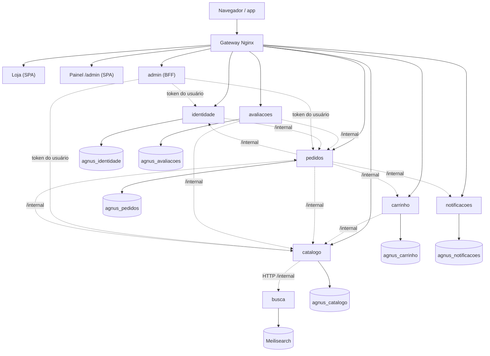
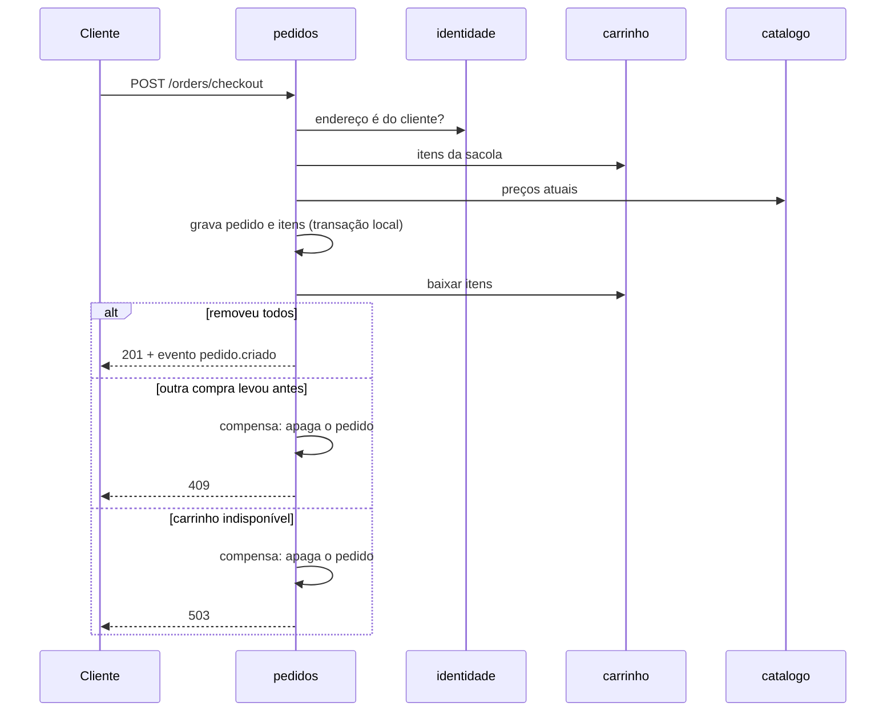

# Mapa dos Microsserviços

Decisão e consequências: [ADR 0008](adr/0008-microsservicos.md).

## Serviços e rotas públicas

Todas as rotas abaixo ficam sob `/api` no gateway.

| Serviço | Rotas públicas | Contrato |
| --- | --- | --- |
| `identidade` | `/auth`, `/users`, `/user-addresses`, `/user-contacts` | [openapi](../../services/identidade/openapi.yaml) |
| `catalogo` | `/products`, `/categories`, `/product-colors`, `/product-grades`, `/product-photos` | [openapi](../../services/catalogo/openapi.yaml) |
| `avaliacoes` | `/product-reviews`, `/product-review-photos` | [openapi](../../services/avaliacoes/openapi.yaml) |
| `carrinho` | `/carts`, `/cart-items` | [openapi](../../services/carrinho/openapi.yaml) |
| `pedidos` | `/orders`, `/order-items` | [openapi](../../services/pedidos/openapi.yaml) |
| `notificacoes` | `/notifications` | [openapi](../../services/notificacoes/openapi.yaml) |
| `admin` | `/admin/dashboard`, `/metrics` (consolidado), `/docs` | Swagger de todos os serviços em `/api/docs/` |
| `busca` | nenhuma | só `/internal/buscar` |

## Contratos internos

Exigem o cabeçalho `x-internal-token` e não passam pelo gateway.

| Dono | Rota | Quem usa | Para quê |
| --- | --- | --- | --- |
| identidade | `GET /internal/usuarios/:id` | todos | Validar o usuário do token |
| identidade | `GET /internal/enderecos/:id` | pedidos | Conferir o dono do endereço |
| catalogo | `POST /internal/produtos/selecoes` | carrinho, pedidos | Preço, nome e foto de cor + grade |
| catalogo | `GET /internal/produtos/:id/cores` | avaliacoes | Produto existe e quais cores tem |
| catalogo | `GET /internal/produtos/documentos` | busca | Documentos para indexar |
| busca | `POST /internal/buscar` | catalogo | Pesquisa textual |
| carrinho | `GET /internal/usuarios/:id/itens` | pedidos | Ler a sacola no checkout |
| carrinho | `POST /internal/itens/baixar` | pedidos | Baixa atômica; devolve quantos itens removeu |
| pedidos | `POST /internal/itens/contagem` | catalogo | Produto usado em pedido não pode ser excluído |
| pedidos | `POST /internal/compras/entregues` | avaliacoes | Só quem recebeu avalia |
| pedidos | `GET /internal/vinculos` | identidade | Usuário ou endereço em uso |
| pedidos | `GET /internal/vendas` | catalogo | Fonte do "mais vendidos" |
| notificacoes | `POST /internal/status-pedido` | pedidos | Aviso ao cliente |

## Eventos (Redis Pub/Sub `agnus.eventos.*`)

| Evento | Publica | Consome |
| --- | --- | --- |
| `produto.criado`, `produto.atualizado` | catalogo | busca, notificacoes (auditoria) |
| `produto.removido` | catalogo | busca, carrinho, avaliacoes |
| `categoria.*` | catalogo | busca |
| `pedido.criado`, `pedido.atualizado` | pedidos | catalogo (vendas), notificacoes |
| `pedido.removido` | pedidos | catalogo, notificacoes |
| `vendas.atualizadas` | catalogo | busca |
| `usuario.removido` | identidade | carrinho, avaliacoes, notificacoes |

## Saga do checkout

## Esquema dos bancos

Cada serviço versiona o próprio esquema em `src/migracoes`. A primeira migration (`0001-esquema-inicial`) foi gerada a partir do banco em uso e não altera tabelas que já existem. As seguintes entram no fim da lista. O que já rodou fica registrado em `agnus_migracoes`, dentro do banco de cada serviço.

## Migração dos dados

O container `migrador` roda [`migrar-bancos.sh`](../../services/scripts/migrar-bancos.sh) a cada subida. Ele cria os bancos e usuários e copia cada tabela do banco antigo só se ela ainda não existir no destino. O banco antigo (`agnus`) é apenas lido e pode ser removido depois de validar o novo ambiente.
