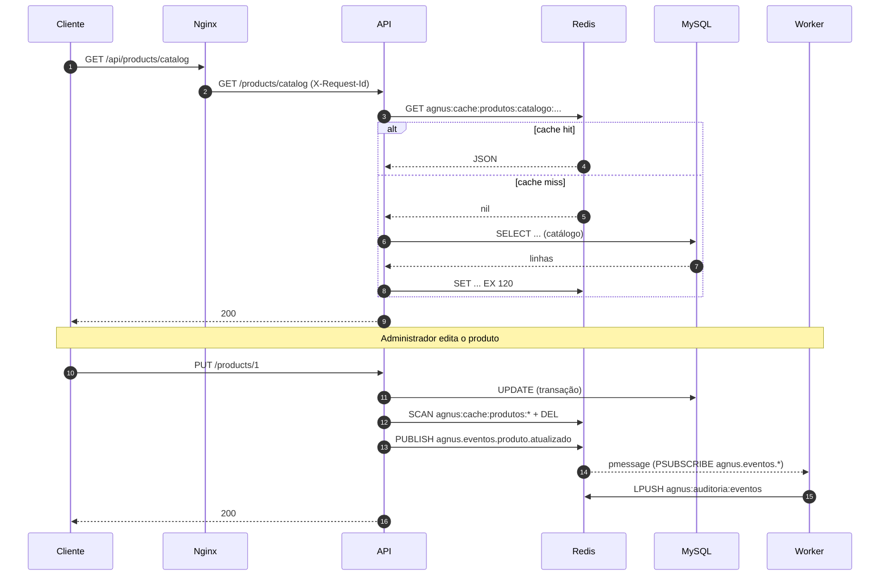

# Redis: Cache Distribuído e Mensageria (roteiro de demonstração)

Implementação: [`cache.service.ts`](../../agnus-back/src/services/cache.service.ts), [`eventBus.service.ts`](../../agnus-back/src/services/eventBus.service.ts), [`worker.ts`](../../agnus-back/src/worker.ts), [`config/redis.ts`](../../agnus-back/src/config/redis.ts), [`config/cache.ts`](../../agnus-back/src/config/cache.ts). Decisões: [ADR 0003](../arquitetura/adr/0003-cache-redis-cache-aside.md) e [ADR 0004](../arquitetura/adr/0004-eventos-redis-pubsub.md).

## Visão geral



## Onde o cache é usado

| Rota | Chave (exemplo) | TTL | Invalidada por |
| --- | --- | --- | --- |
| `GET /products` | `produtos:lista:limit=10&page=1` | 120 s | produto, categoria, foto |
| `GET /products/catalog` | `produtos:catalogo:limit=24&page=1&sort=preco_asc` | 120 s | produto, categoria, foto |
| `GET /products/best-sellers` | `produtos:mais-vendidos:...` | **60 s** | produto, categoria, foto (vendas: só pelo TTL) |
| `GET /products/:id` | `produtos:detalhe:id=1` | 300 s | produto, categoria, foto |
| `GET /categories` | `categorias:lista:limit=10&page=1` | 600 s | categoria |
| `GET /categories/:id` | `categorias:detalhe:id=1` | 600 s | categoria |

Todas as chaves recebem o prefixo `agnus:cache:`.

## Eventos publicados

| Canal | Quando | Payload |
| --- | --- | --- |
| `agnus.eventos.produto.criado` / `.atualizado` / `.removido` | CRUD de produto | `id_produto`, `nome`, `ativo` |
| `agnus.eventos.categoria.criada` / `.atualizada` / `.removida` | CRUD de categoria | `id_categoria`, `nome` |
| `agnus.eventos.pedido.criado` | `POST /orders` | `id_pedido`, `id_usuario`, `status`, `valor_total` |
| `agnus.eventos.pedido.atualizado` | `PUT /orders/:id` | `id_pedido`, `id_usuario`, `status_anterior`, `status` |
| `agnus.eventos.pedido.removido` | `DELETE /orders/:id` | `id_pedido` |

O worker registra **todos** os eventos na auditoria e trata dois deles: `pedido.criado` gera `notificacao.equipe_vendas` e `pedido.atualizado` com mudança de status gera `notificacao.cliente`.

## Roteiro de demonstração (≈ 5 min)

Pré-requisitos: `docker compose up -d --build` e um token de administrador em `$TOKEN`.

```bash
API=https://localhost/api
```

**Terminal 1: acompanhar os logs**

```bash
docker compose logs -f backend worker | grep -E 'cache\.|evento\.|notificacao\.'
```

**Terminal 2: provocar os fluxos**

```bash
# 1) Cache-aside: miss -> hit
curl -sk "$API/products/catalog?page=1&limit=10" > /dev/null   # log: cache.miss
curl -sk "$API/products/catalog?page=1&limit=10" > /dev/null   # log: cache.hit

# 2) TTL
docker exec agnus-redis redis-cli --scan --pattern 'agnus:cache:*'
docker exec agnus-redis redis-cli TTL 'agnus:cache:produtos:catalogo:limit=10&page=1'   # ex.: 117

# 3) Invalidação em update
curl -sk -X PUT "$API/products/1" -H "Authorization: Bearer $TOKEN" \
     -H 'Content-Type: application/json' -d '{"nome":"Nome alterado"}'
#    logs: cache.invalidado {namespace: produtos, removedKeys: N}  +  evento.publicado
docker exec agnus-redis redis-cli --scan --pattern 'agnus:cache:produtos:*'   # vazio
curl -sk "$API/products/1"                                                    # já vem com o nome novo (cache.miss)

# 4) Pub/Sub: pedido
curl -sk -X PUT "$API/orders/1" -H "Authorization: Bearer $TOKEN" \
     -H 'Content-Type: application/json' -d '{"status":"enviado"}'
#    API:    evento.publicado  {type: pedido.atualizado, receivers: 1}
#    Worker: evento.recebido   {origemRequestId: <mesmo requestId da API>}
#            notificacao.cliente {statusAnterior: pago, statusNovo: enviado}

# 5) Assinar o canal "na mão" (prova independente da circulação)
docker exec -it agnus-redis redis-cli PSUBSCRIBE 'agnus.eventos.*'

# 6) Trilha de auditoria gravada pelo worker
docker exec agnus-redis redis-cli LRANGE agnus:auditoria:eventos 0 4

# 7) Resiliência: Redis fora -> API continua respondendo
docker stop agnus-redis
curl -sk -o /dev/null -w '%{http_code}\n' "$API/products/catalog"   # 200
docker start agnus-redis                                             # reconecta sozinho

# 8) Métricas
curl -sk -H "Authorization: Bearer $TOKEN" "$API/metrics"     # (somente admin) cache_hits_total, cache_misses_total, sli.cacheHitRatio, events_published_total
```

### Saída real (execução de 2026-11-02)

```text
API     cache.miss          key=produtos:catalogo:limit=10&page=1          requestId=45ffb749...
API     cache.hit           key=produtos:catalogo:limit=10&page=1          requestId=90c927a7...
API     cache.invalidado    namespace=produtos reason=produto.atualizado:1 removedKeys=2
API     evento.publicado    type=produto.atualizado receivers=1            requestId=cf73c0c6...
WORKER  evento.recebido     type=produto.atualizado origemRequestId=cf73c0c6...
API     evento.publicado    type=pedido.criado receivers=1                 requestId=412e4812...
WORKER  evento.recebido     type=pedido.criado origemRequestId=412e4812...
WORKER  notificacao.equipe_vendas  pedido=1
WORKER  notificacao.cliente        pedido=1 statusAnterior=aguardando_pagamento statusNovo=pago
```

## Testes automatizados

- [`tests/services/cache.service.spec.ts`](../../agnus-back/tests/services/cache.service.spec.ts): chaves, hit/miss, TTL, `shouldCache`, invalidação por SCAN, circuit breaker, Redis indisponível.
- [`tests/services/eventBus.service.spec.ts`](../../agnus-back/tests/services/eventBus.service.spec.ts): envelope, canal, falha de publicação, assinatura, isolamento de erro do handler.
- [`tests/utils/observability.spec.ts`](../../agnus-back/tests/utils/observability.spec.ts): logger JSON, `X-Request-Id`, métricas.
