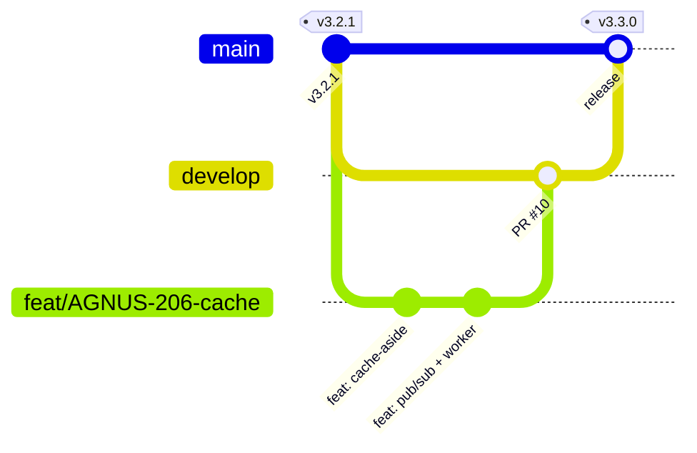

# Versionamento e Lançamento de Versões Parciais

## Padrão

- **SemVer** `MAJOR.MINOR.PATCH`:
  - **MAJOR**: nova fase do produto ou quebra de contrato da API (ex.: 3.0.0, app mobile; 4.0.0, pagamento).
  - **MINOR**: funcionalidade nova compatível (ex.: 3.3.0, cache e eventos).
  - **PATCH**: correção sem funcionalidade nova (ex.: 3.2.1, correção do CI).
- **Fonte da verdade:** tags anotadas no Git (`v3.3.0`). A mesma versão aparece no Jira (*Fix Version*), no `openapi.yaml` (`info.version`), nas imagens Docker (`agnus-backend:v3.3.0`) e no [CHANGELOG](../../CHANGELOG.md).
- **Commits:** [Conventional Commits](https://www.conventionalcommits.org/pt-br/), validados pelo commitlint no hook `commit-msg`. O tipo do commit indica o impacto: `feat` → MINOR, `fix` → PATCH, `feat!`/`BREAKING CHANGE` → MAJOR.

## Fluxo de branches



1. `feat/*`, `fix/*`, `chore/*` saem de `develop` (ou de `main` em correções urgentes).
2. PR com template e CI verde → merge em `develop`.
3. Fim da sprint → PR `develop → main` → **tag** → o `cd.yml` publica as imagens e faz o deploy.

## Como lançar uma versão

```bash
git checkout main && git pull
# 1. Atualizar CHANGELOG.md (mover "Não lançado" para a nova versão) e info.version do openapi.yaml
git commit -am "chore(release): v3.3.0"
git tag -a v3.3.0 -m "Release 3.3.0: cache Redis, eventos e observabilidade"
git push origin main --tags        # dispara o cd.yml
# 2. Jira → Versões → Lançar 3.3.0
# 3. GitHub → Releases → criar a partir da tag, colando a seção do CHANGELOG
```

## Histórico de versões do produto

As "versões" de negócio do [readme](../../readme.md) mapeiam para versões MAJOR:

| Versão de negócio | SemVer | Entrega |
| --- | --- | --- |
| 1ª — Catálogo online (landing page) | 1.x | Anterior a este repositório |
| 2ª — E-commerce | 2.x | Cadastro, catálogo, carrinho, pedidos, painel |
| 3ª — Mobile e responsividade | 3.x | Login Google no app, upload, cache, eventos |
| 4ª — Pagamento online | 4.0.0 | Mercado Pago (em andamento) |

> As tags 2.0.0 a 3.2.1 foram **definidas retroativamente** a partir dos PRs e datas do histórico do Git (ver CHANGELOG). Para formalizá-las:
>
> ```bash
> git tag -a v2.0.0 c646f5ce -m "E-commerce"
> git tag -a v2.1.0 4eaa4ce0 -m "Husky, ESLint e Commitlint"
> git tag -a v2.2.0 d2a312e0 -m "CI, template de PR e Nginx dedicado"
> git tag -a v3.0.0 f6fa1bf5 -m "Login Google no app mobile"
> git tag -a v3.1.0 a027f047 -m "Ordenação por preço e requisitos"
> git tag -a v3.2.0 cbc87c9b -m "Upload Multer e controle admin"
> git tag -a v3.2.1 7b3d2b39 -m "ngrok e correção do CI"
> git push origin --tags
> ```
