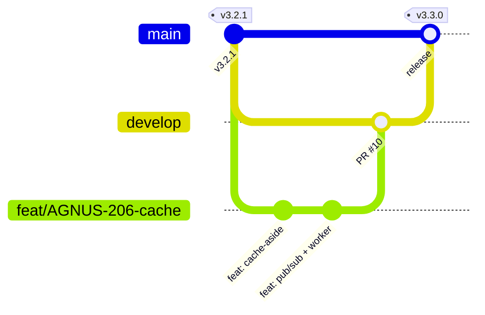

# Versionamento e Lançamento de Versões Parciais

## Padrão

- **SemVer** `MAJOR.MINOR.PATCH`:
  - **MAJOR**: nova fase do produto ou quebra de contrato da API (ex.: 3.0.0, app mobile; 4.0.0, pagamento).
  - **MINOR**: funcionalidade nova compatível (ex.: 3.3.0, cache e eventos; 3.5.0, microsserviços sem mudança no contrato público).
  - **PATCH**: correção sem funcionalidade nova (ex.: 3.2.1, correção do CI).
- **Fonte da verdade:** tags anotadas no Git (`v3.3.0`). A mesma versão aparece no Jira (*Fix Version*), no `openapi.yaml` (`info.version`), nas imagens Docker (`agnus-backend:v3.3.0`) e no [CHANGELOG](../../CHANGELOG.md).
- **Commits:** [Conventional Commits](https://www.conventionalcommits.org/pt-br/), validados pelo commitlint no hook `commit-msg`. O tipo do commit indica o impacto: `feat` → MINOR, `fix` → PATCH, `feat!`/`BREAKING CHANGE` → MAJOR.

## Fluxo de branches



1. `feat/*`, `fix/*`, `chore/*` saem de `main`.
2. PR com template e CI verde → merge em `main`.
3. Fim da sprint → **tag** → o `cd.yml` publica as imagens e faz o deploy.

## Como lançar uma versão

```bash
git checkout main && git pull
# 1. Atualizar CHANGELOG.md (mover "Não lançado" para a nova versão) e info.version do openapi.yaml
git commit -am "chore(release): v3.3.0"
git tag -a v3.3.0 -m "Release 3.3.0: cache Redis, eventos e observabilidade"
git push origin main --tags        # dispara o cd.yml
# 2. Jira → Versões → Lançar 3.3.0
# 3. GitHub → Releases → criar a partir da tag, colando a seção do CHANGELOG
```

## Histórico de versões do produto

As "versões" de negócio do [readme](../../readme.md) mapeiam para versões MAJOR:

| Versão de negócio | SemVer | Entrega |
| --- | --- | --- |
| 1ª — Catálogo online (landing page) | 1.x | Anterior a este repositório |
| 2ª — E-commerce | 2.x | Cadastro, catálogo, carrinho, pedidos, painel |
| 3ª — Mobile e responsividade | 3.x | Login Google no app, upload, cache, eventos |
| 4ª — Pagamento online | 4.0.0 | Mercado Pago (em andamento) |

## Tags e releases publicadas

Cada versão é uma **tag anotada** no Git com uma **Release** no GitHub (notas copiadas do [CHANGELOG](../../CHANGELOG.md)): <https://github.com/LuizZamzicki/agnus-composer/releases>.

| Tag | Commit | Data | Conteúdo |
| --- | --- | --- | --- |
| `v2.0.0` | `c646f5ce` | 2026-06-16 | E-commerce |
| `v2.1.0` | `4eaa4ce0` | 2026-06-25 | Husky, ESLint e Commitlint |
| `v2.2.0` | `d2a312e0` | 2026-08-31 | CI, template de PR e Nginx dedicado (PR #1) |
| `v3.0.0` | `f6fa1bf5` | 2026-09-08 | Login Google no app mobile |
| `v3.1.0` | `a027f047` | 2026-09-16 | Ordenação por preço e requisitos (PRs #2–#7) |
| `v3.2.0` | `cbc87c9b` | 2026-09-17 | Upload Multer e controle admin (PR #8) |
| `v3.2.1` | `7b3d2b39` | 2026-09-17 | ngrok e correção do CI (PR #9) |
| `v3.3.0` | `ecbb0ac8` | 2026-11-03 | Redis (cache e eventos), observabilidade, nova identidade visual, fluxo de compra, segurança e documentação (PRs #11–#18) |
| `v3.4.0` | `b1933d55` | 2026-11-06 | Criada antes do merge das correções: o conteúdo descrito na 3.4.0 entrou de fato na `v3.5.0` |
| `v3.5.0` | commit de release | 2026-11-09 | Microsserviços com banco por serviço, painel separado, regras do pedido, segurança, notificações e correção do CD |

As tags de `v2.0.0` a `v3.2.1` foram criadas **retroativamente**, nos commits de merge correspondentes do histórico. Elas não disparam o CD, porque o `cd.yml` só existe a partir da 3.3.0. A partir da `v3.3.0`, cada tag dispara o [`cd.yml`](../../.github/workflows/cd.yml), que roda os testes e publica as imagens versionadas no GHCR.
